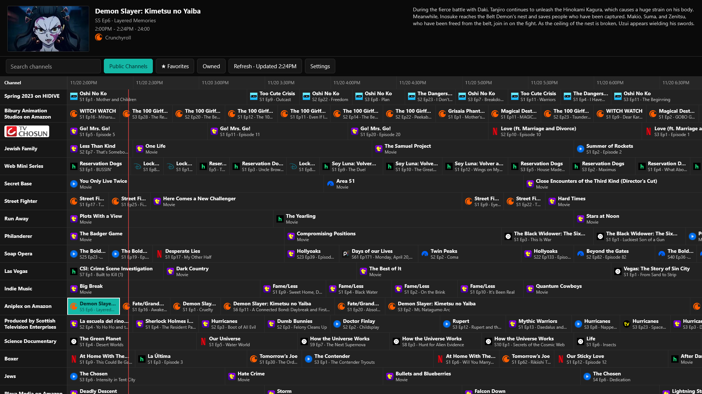

# Stream Channeler Multiplatform

The Stream Channeler app for Windows, macOS, and Linux. It uses any web browser
that supports userscripts, so hypothetically it also supports FreeBSD, ChromeOS, Android, iOS, and SteamOS, but they have
not been tested. It automatically plays your [Stream Channeler](https://streamchanneler.com/) channels like a real TV
channel by interacting with the streaming websites that host the videos. Channels are created and edited on
[Stream Channeler's website](https://streamchanneler.com/).



## Features

- Plays the next video on the channel automatically
- Skips recaps, intros, credits and previews
- Picks your profile and enters its PIN
- Presses Play on websites that wait for a click
- Fills the window with the video

## Install

1. Install a userscript manager: [Tampermonkey](https://www.tampermonkey.net/) (recommended), [Violentmonkey](https://violentmonkey.github.io/) or [ScriptCat](https://scriptcat.org/). In Chrome and Edge, Tampermonkey also needs **Allow User Scripts** turned on in the browser's extension details page.
2. Open [stream-channeler.user.js from the latest release](https://github.com/ryn-cx/stream-channeler-multiplatform/releases/latest/download/stream-channeler.user.js) and install it when the userscript manager asks.
3. Allow each streaming website you use to autoplay video with sound. In Chrome and Edge, open the website, click the icon to the left of the address, open **Site settings** and set **Sound** to **Allow**. In Firefox, click the icon to the left of the address and set **Autoplay** to **Allow Audio and Video**.

## How to use

1. Open <https://streamchanneler.com/open-app>, or click **Open App** in the header of [Stream Channeler's website](https://streamchanneler.com/).
2. Sign in with a code or your email and password, or continue without signing in to browse public channels.
3. Pick a video in the guide to start watching the channel.

## Streaming Website Compatibility


| Website            | Auto Start | Recap Detection | Intro Detection | Credits Detection | Preview Detection | Next Episode Detection | Next Episode Dismissed | Video Completion Detection | Profile Selector | Pin Entry | Automatic fullscreen |
| ------------------ | ---------- | --------------- | --------------- | ----------------- | ----------------- | ---------------------- | ---------------------- | -------------------------- | ---------------- | --------- | -------------------- |
| Amazon Prime Video | ✔️         | ✅               | ✅               | ✔️                | ✔️                | ✅                      | ✅                      | ✅                          | ❌<sup>[1](#streaming-website-note-1)</sup>               | ✔️        | ✔️                   |
| Crunchyroll        | ✔️         | ✅               | ✅               | ✅                 | ✅                 | ✔️                     | ✔️                     | ✅                          | ✅                | ✅         | ✅                    |
| Disney+            | ✔️         | ✅               | ✅               | ✅                 | ✔️                | ✅                      | ✔️                     | ❌<sup>[2](#streaming-website-note-2)</sup>                         | ✅                | ✅         | ✔️                   |
| HBO Max            | ✔️         | ✅               | ✅               | ✔️                | ✔️                | ✅                      | ✔️                     | ✅                          | ✅                | ✅         | ✔️                   |
| HIDIVE             | ✔️         | ✔️              | ✔️              | ✔️                | ✔️                | ✔️                     | ✔️                     | ✅                          | ✅                | ✔️        | ✔️                   |
| Hulu               | ✔️         | ✅               | ✅               | ✔️                | ✔️                | ✅                      | ✅                      | ✅                          |                  |           | ✔️                   |
| Internet Archive   | ✅          | ✔️              | ✔️              | ✔️                | ✔️                | ✔️                     | ✔️                     | ✅                          | ✔️               | ✔️        | ✅                    |
| Netflix            | ✔️         | ✔️              | ✅               | ✔️                | ✔️                | ✅                      | ✅                      | ✅                          | ✅                | ✅         | ✔️                   |
| NHK World          | ✔️         | ✔️              | ✔️              | ✔️                | ✔️                | ✔️                     | ✔️                     | ✅                          | ✔️               | ✔️        | ✅                    |
| Paramount+         | ✅<sup>[3](#streaming-website-note-3)</sup>         |                 | ✅               | ✔️                | ✔️                | ✅                      | ✅                      | ✅                          | ✅                | ✔️        | ✔️                   |
| PBS<sup>[4](#streaming-website-note-4)</sup>              | ✔️         | ✔️              | ✔️              | ✔️                | ✔️                | ✔️                     | ✔️                     | ✅                          | ✔️               | ✔️        | ✅                    |
| Peacock            | ✔️         | ✔️              | ✅               | ✔️                | ✔️                | ✅                      | ✅                      | ✅                          | ✅                | ✅         | ✔️                   |
| Pluto TV           | ✔️         | ✅               | ✔️              | ✔️                | ✔️                | ✅                      | ✅                      | ✅                          | ✔️               | ✔️        | ✔️                   |
| Tubi               | ✔️         | ✔️              | ✔️              | ✔️                | ✔️                | ✅                      | ✅                      | ✅                          | ✔️               | ✔️        | ✅                    |
| YouTube            | ✔️         | ✔️              | ✔️              | ✔️                | ✔️                | ✔️                     | ✔️                     | ✅                          | ✔️               | ✔️        | ✅                    |

1. <a id="streaming-website-note-1"></a>Partially implemented, opening the URL always uses the active profile because the profile selection screen is never shown.
2. <a id="streaming-website-note-2"></a>Not yet supported, currently episodes end whenever the end screen comes up which can cause some credits to be skipped.
3. <a id="streaming-website-note-3"></a>Only needed for movies.
4. <a id="streaming-website-note-4"></a>PBS is currently disabled.

Profile names, profile numbers and PINs are saved to your account, so the other Stream Channeler apps use them too.


## Advanced Controls

| Keyboard | Controller | Action |
| --- | --- | --- |
| Arrow keys | D-pad or left stick | Move through the guide and menus |
| Enter or Space | A | Select the highlighted item |
| Hold Enter | Hold A | Change the highlighted episode's watch status |
| `,` and `.` (or `[` and `]`) | LB / RB | Page the timeline earlier or later |
| Page Up / Page Down | LT / RT | Page through channels |
| Home / End | | Jump to the first or last channel |
| Esc or Backspace | B | Move from the guide up to the toolbar, cancel **Up next** or the next episode countdown, or close Settings |
| `m` | Start | Change the highlighted episode's watch status, or open Settings when no episode is highlighted |
| `s` | | Settings |
| `g` | | Jump to the guide |
| `/` | X | Search channels |
| `c` | Y | Resort or check the highlighted channel |
| `r` | Back (View) | Refresh the guide |

The mouse and touch screens work too: drag or scroll to move around the guide, click a video to see its details and click it again to play it, and right-click a video for its menu.


## Build

```bash
npm run build
```

`dist/stream-channeler.user.js` is the final script. You can manually copy it to Greasy Fork to deploy it.

## Contributing

Contributions must be made under the [Contributor License Agreement](CLA.md). The agreement assigns ownership of every contribution to Stream Channeler. Accept it by adding the sentence from the agreement's **How to accept** section to the description of your first pull request.

## License

Copyright (C) 2026 Stream Channeler

This project is licensed under the [GNU Affero General Public License v3.0](LICENSE).
